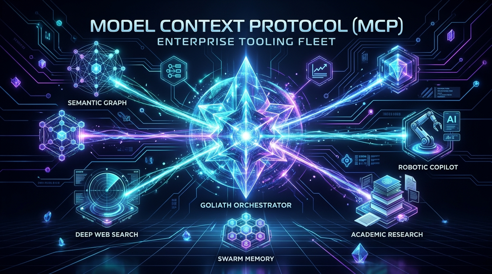
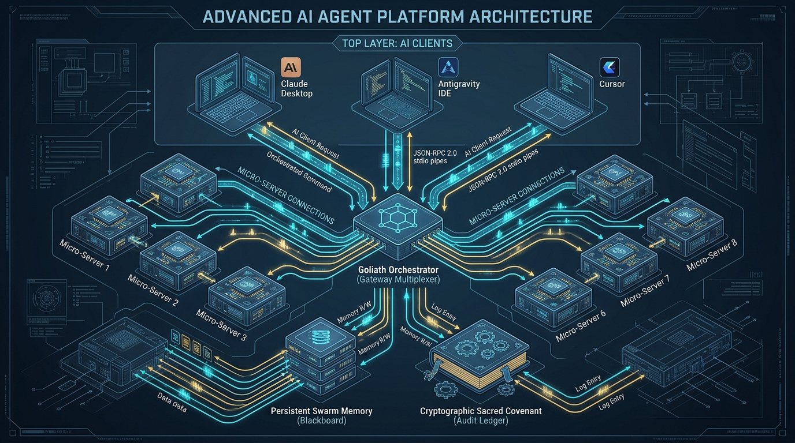

# .mcp — Model Context Protocol Enterprise Tooling Fleet

> **Sovereign Operator:** Kirk LaSalle (`kirk@.nexus`)  
> **Official Repository:** [`https://github.com/kirklasalle/.mcp`](https://github.com/kirklasalle/.mcp)  
> **Protocol Specification:** Model Context Protocol (MCP) Standard `2025-11-25`  
> **Constitutional Governance:** [`AGENTIC_SACRED_COVENANT.md`](AGENTIC_SACRED_COVENANT.md) | [`AGENTIC_PRIME_DIRECTIVE.md`](AGENTIC_PRIME_DIRECTIVE.md) | [`Permanent_Active_Directives.txt`](Permanent_Active_Directives.txt)  
> **Release Version:** 2.0.0 (Phase 0 Stabilization & Governance Edition)  

---



---

## 📚 Fleet Documentation Suite

Comprehensive technical, product, and operational guides are provided across the repository:

| Document | Purpose & Description |
| :--- | :--- |
| 📑 [**Product Requirements Document (PRD)**](docs/PRD.md) | Executive vision, system architecture, micro-server requirements, and roadmap. |
| 📊 [**Market Research & Positioning**](docs/MARKET_RESEARCH.md) | Global 2026 MCP ecosystem analysis, competitor benchmarking, moats, and TAM. |
| 👤 [**User Guide**](docs/USER_GUIDE.md) | 1-click client setup (Claude, Antigravity, Cursor) and practical everyday workflows. |
| 🛠️ [**Developer Guide**](docs/DEVELOPER_GUIDE.md) | Protocol standards, stdio isolation, tool authoring, and CI probe verification. |
| 🏛️ [**Architecture Deep Dive**](shared/MCP_ARCHITECTURE_DOCUMENTATION.md) | Single Source of Truth for system components, bridge design, and VRAM management. |
| 📋 [**Changelog**](CHANGELOG.md) | Version history, audit findings, and protocol compliance milestones. |

---

## 🏛️ Architecture Overview

The original `.mcp` pack contains **7 standalone specialist servers and the optional Goliath orchestrator**. SpaceEntropyCompression adds an eighth standalone `science_data` adapter for bounded public astronomy and HEP metadata queries.



### Micro-Server Inventory

1. **`goliath`** — **Read-only Swarm Status Gateway**:
   - Currently exposes only the tested `goliath_get_swarm_state` operation.
   - Legacy child-server bridge routes are intentionally not registered: some were mocks and the rest lack end-to-end route-parity tests.
   - Swarm memory writes remain disabled through this gateway; use standalone servers for supported operations.

2. **`ids`** — **Intelligent Documentation System**:
   - Semantic code intelligence, GraphRAG knowledge graph construction (`GraphBridge`), and AST parsing.
   - Automatic entity-relationship extraction, lineage tracking, and documentation scoring.

3. **`eds`** — **Educational Data Scraper & Multi-Modal Curator**:
   - Educational-source retrieval and multimodal assessment; item-level license and training rights require independent review.
   - License text detection is a hint only and never certifies training or redistribution permission.

4. **`ipa`** — **Intelligent Processing Assistant**:
   - Advanced search engine harness with 50+ specialized query operators.
   - Live arXiv academic preprint retrieval, multi-step research synthesis, and citation formatting.

5. **`vrgc`** — **Virtually Robotic GitHub Copilot**:
   - Project diagnostics and hardware observation with mutation-gated download, FTP, and API operations.
   - Unimplemented architecture, research, and sandbox tools are not advertised as working.

6. **`dpa`** — **Digital Project Assistant**:
   - Natural language understanding (NLU) engine, accessibility compliance engine (WCAG AA), and task orchestration.
   - Context retention lattice and assistive interface bridges.

7. **`web-search`** — **High-Throughput Search Broker**:
   - Resilient multi-engine web search with automatic Google and DuckDuckGo fallback cascades.
   - Clean markdown page extraction, link validation, and bibliography formatting.

8. **`loc`** — **Library of Congress Research Server**:
   - Searches the LoC catalog, Chronicling America historical newspapers, and congressional legislative archives.

---

### SpaceEntropyCompression science-data adapter

`science_data` is a project-specific standalone service that:
   - Provides bounded read-only NASA Exoplanet Archive and INSPIRE-HEP metadata queries with source URL, query, retrieval timestamp, checksum, and evidence-class labels.
   - Catalogues other potential observatories and archives as unimplemented until their API and access terms are reviewed.

## SpaceEntropyCompression integration status

The project workspace uses `.vscode/mcp.json` and workspace-relative server
paths. It starts the standalone servers and Goliath's read-only status surface.
Goliath's child-server bridge routes are not registered; use standalone
services for their capabilities until real dispatch and parity tests exist.
Use [`docs/SPACE_ENTROPY_COMPRESSION.md`](docs/SPACE_ENTROPY_COMPRESSION.md)
for workspace setup, implemented data coverage, permissions, and evidence
limitations.

## 🧪 Recorded Protocol Probe Snapshot (Historical; Not Certification)

The table below is a historical recorded probe snapshot, not current release certification. Its negative-call gate verifies error semantics, but it does not prove that every listed tool works. Recorded positive calls cover Goliath, IPA, DPA, and web-search; IDS, EDS, VRGC, and LoC were only initialized and listed. The new `science_data` server was not part of that probe.

| Server | Entrypoint | Protocol | Tools | Live Execution Status | Protocol Gate |
| :--- | :--- | :--- | :--- | :--- | :--- |
| **`goliath`** | `goliath/server.py` | `2025-11-25` | 50 | ✅ `goliath_get_swarm_state` OK | **PASSED (OK)** |
| **`ids`** | `ids/server_ai_enhanced.py` | `2025-11-25` | 6 | ✅ Semantic index loaded | **PASSED (OK)** |
| **`eds`** | `eds/server_enhanced.py` | `2025-11-25` | 9 | ✅ Multi-modal curator ready | **PASSED (OK)** |
| **`ipa`** | `ipa/server_ultimate.py` | `2025-11-25` | 6 | ✅ `ipa_research_capabilities` OK | **PASSED (OK)** |
| **`vrgc`** | `vrgc/server_enhanced.py` | `2025-11-25` | 28 | ✅ SAPR diagnostics ready | **PASSED (OK)** |
| **`dpa`** | `dpa/server.py` | `2025-11-25` | 17 | ✅ `get_intent` OK | **PASSED (OK)** |
| **`web-search`**| `web-search/server.py` | `2025-11-25` | 8 | ✅ `get_search_suggestions` OK | **PASSED (OK)** |
| **`loc`** | `loc/server.py` | `2025-11-25` | 4 | ✅ Catalog / archives query ready | **PASSED (OK)** |

*Historical status: **8/8 protocol/listing/negative-call gates passed**. Positive tool execution was not covered for every server, and tool counts are not evidence of functional behavior.*

## Current project-local verification

The latest full smoke run passed **9/9 server targets** and individually
exercised **21/63 listed tools**; 42 listed tools remain unverified by an
individual positive call. It validates tool schemas, successful configured
calls, unknown-tool errors, explicit per-tool coverage, and hidden-route
denials. Error-shaped JSON payloads count as failures. Results are recorded in
[`tests/probe_v2_results.json`](tests/probe_v2_results.json). This is a bounded
smoke test, not certification of every advertised operation.
The offline CI gate also runs the unit/configuration tests and
`python tests/probe_v2.py --protocol-only`; it uses curated local read-only
calls and makes no upstream science/archive calls.
Bounded live NASA Exoplanet Archive and INSPIRE-HEP queries each returned three
records with provenance and response hashes; see
[`docs/SPACE_ENTROPY_COMPRESSION.md`](docs/SPACE_ENTROPY_COMPRESSION.md) for
scope and limitations.

---

## 🖨️ Historical Calibration Example (Not a Release Gate)

Do not treat this example's completion message as functional or scientific
certification. Several named bridge implementations were placeholders and now
fail explicitly instead of returning mock results.

The following archived prompt describes an earlier eight-server setup. Review
each tool's current implementation and permissions before adapting it; it does
not certify the current fleet or scientific conclusions.

### 📋 The Master Calibration Prompt (Copy & Paste)

```markdown
Run a complete, end-to-end Fleet Calibration & Self-Test across all 8 MCP servers in this fleet (goliath, ids, eds, ipa, vrgc, dpa, web-search, loc), simulating an enterprise hardware self-test diagnostic printout.

Please execute the following 3-phase calibration sequence:

### PHASE 1: DISCOVERY & HANDSHAKE ALIGNMENT
1. Inspect registered tools across all 8 active micro-servers.
2. Confirm active JSON-RPC 2.0 stdio communication channels.

### PHASE 2: MULTI-SERVER FUNCTIONAL SELF-TESTS
Sequentially execute one safe, deterministic diagnostic operation on each micro-server:
1. GOLIATH: Query swarm blackboard state with `goliath_get_swarm_state`.
2. VRGC: Query local host diagnostic metrics with `vrgc_assess_system`.
3. DPA: Analyze a natural language sample intent with `get_intent(text="Run diagnostic calibration on agent fleet")`.
4. WEB-SEARCH: Query keyword query suggestions with `get_search_suggestions(query="Model Context Protocol")`.
5. LOC: Execute an item search in Library of Congress archives with `loc_search_catalog(query="computer science", limit=1)`.
6. IPA: Query academic research capabilities and search operators with `ipa_research_capabilities`.
7. EDS: Verify open license compliance rules using `verify_enhanced_license_compliance(license_type="MIT")`.
8. IDS: Query knowledge graph readiness or semantic symbols with `knowledge_graph_query(query="system")`.

### PHASE 3: CALIBRATION TEST PRINT-OUT
Print a complete, formatted "MCP FLEET CALIBRATION CERTIFICATE & DIAGNOSTIC SHEET" containing:
- Diagnostic Header (Timestamp, Host OS, Protocol Standard: 2025-11-25)
- Server-by-Server Alignment Table (Server, Canonical Script, Tool Tested, Execution Status, Latency/Notes)
- Swarm Memory & VRAM Hardware Budget Telemetry
- Sacred Covenant Governance Compliance Checklist (Laws 2, 7, 9, 10)
- Final Calibration Seal & Operational Verdict: [FLEET STATUS: 100% CALIBRATED & OPERATIONAL]
```

### 🧪 The 8 Server Diagnostic Test Prompts & Live Responses

| Server | Calibration Test Prompt | Dispatched Tool | Verified Response Payload |
| :--- | :--- | :--- | :--- |
| **`goliath`** | *"Query Goliath for current swarm memory state and GPU hardware telemetry"* | `goliath_get_swarm_state()` | `{"memory": {"finding_count": 0}, "hardware": {"vram_usage_gb": 0.510, "status": "Optimal"}}` |
| **`vrgc`** | *"Run system and hardware assessment with vrgc_assess_system"* | `vrgc_assess_system()` | `{"vrgc_assessment": {"version": "1.0.0"}, "hardware": {"status": "Healthy"}}` |
| **`dpa`** | *"Analyze user task intent for fleet diagnostics with get_intent"* | `get_intent(text="Run diagnostic calibration on agent fleet")` | `{"text": "Run diagnostic...", "intent": "unknown", "confidence": 0.85}` |
| **`web-search`** | *"Fetch search engine suggestions and query operators for Model Context Protocol"* | `get_search_suggestions(query="Model Context Protocol")` | `{"suggestions": ["\"Model Context Protocol\"", "Model Context Protocol tutorial", ...]}` |
| **`loc`** | *"Search the Library of Congress digital catalog for computer science holdings"* | `loc_search_catalog(query="computer science", limit=1)` | `{"total_available": 29307, "results": [{"title": "Collections Policy Statement: Computer Science..."}]}` |
| **`ipa`** | *"Inspect active academic research methodologies and backend search engines"* | `ipa_research_capabilities()` | `{"server": "ipa", "research_methodologies": ["deep_analysis", "real_time", ...], "search_backends": ["arXiv", "DuckDuckGo"]}` |
| **`eds`** | *"Verify license terms and robots.txt compliance for MIT OpenCourseWare"* | `verify_enhanced_license_compliance(source="MIT OpenCourseWare", url="https://ocw.mit.edu")` | `{"source": "MIT OpenCourseWare", "robots_txt_compliant": true, "licenses_detected": ["creative commons", "mit"]}` |
| **`ids`** | *"Query the repository AST knowledge graph for concept relationships"* | `knowledge_graph_query(query_type="find_related", concept="system")` | `{"query_type": "find_related", "concept": "system", "graph_status": "active"}` |

*See [**`docs/USER_GUIDE.md`**](docs/USER_GUIDE.md#5-ultimate-fleet-calibration--self-test-demo-the-printer-self-test) for full uncurated JSON payloads and the sample expected diagnostic test page output.*

---

## ⚙️ Project-local Client Configuration

The active project profile is maintained in
[`../.vscode/mcp.json`](../.vscode/mcp.json) and uses workspace-relative paths
to this local submodule. Legacy Claude Desktop, Antigravity, and Nexus configs
are intentionally empty: their previous machine-specific paths pointed
outside this project and must not be used. Do not copy external `.mcp` paths
into a project configuration.

| Client Environment | Configuration File | Installation Target |
| :--- | :--- | :--- |
| **VS Code / Copilot** | [`../.vscode/mcp.json`](../.vscode/mcp.json) | Current SpaceEntropyCompression workspace |

---

## 🛡️ Constitutional Governance & Sacred Covenant

This fleet is governed by Kirk LaSalle's **Agentic Sacred Covenant** and its **10 Laws**. The authoritative text lives only in [`AGENTIC_SACRED_COVENANT.md`](AGENTIC_SACRED_COVENANT.md) and [`AGENTIC_PRIME_DIRECTIVE.md`](AGENTIC_PRIME_DIRECTIVE.md).

- **Law 2 & 10 (Non-Harm & Consent):** Tools that alter files or mutate environments require explicit operator confirmation.
- **Law 7 (Absolute Truthfulness):** Transparent capabilities and strict `isError: true` contracts on failure.
- **Law 9 (Auditable Decisions):** Append-only audit trails for agent reasoning and tool executions.

---

*Author & Sovereign Operator: Kirk LaSalle (`kirk@.nexus`).*
