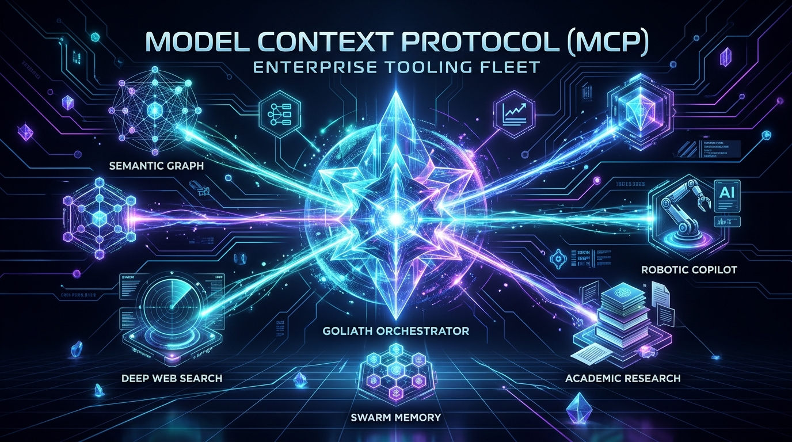
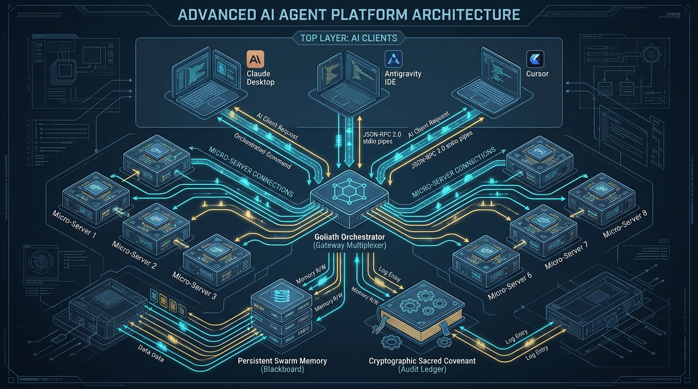

# .mcp — Model Context Protocol Enterprise Tooling Fleet

> **Sovereign Operator:** Kirk LaSalle (`kirk@.nexus`)  
> **Official Repository:** [`https://github.com/kirklasalle/.mcp`](https://github.com/kirklasalle/.mcp)  
> **Protocol Specification:** Model Context Protocol (MCP) Standard `2025-11-25`  
> **Constitutional Governance:** [`AGENTIC_SACRED_COVENANT.md`](AGENTIC_SACRED_COVENANT.md) | [`AGENTIC_PRIME_DIRECTIVE.md`](AGENTIC_PRIME_DIRECTIVE.md) | [`Permanent_Active_Directives.txt`](Permanent_Active_Directives.txt)  
> **Release Version:** 2.0.0 (Phase 0 Stabilization & Governance Edition)  

---



---

## 📚 Fleet Documentation Suite

Comprehensive technical, product, and operational guides are provided across the repository:

| Document | Purpose & Description |
| :--- | :--- |
| 📑 [**Product Requirements Document (PRD)**](docs/PRD.md) | Executive vision, system architecture, micro-server requirements, and roadmap. |
| 👤 [**User Guide**](docs/USER_GUIDE.md) | 1-click client setup (Claude, Antigravity, Cursor) and practical everyday workflows. |
| 🛠️ [**Developer Guide**](docs/DEVELOPER_GUIDE.md) | Protocol standards, stdio isolation, tool authoring, and CI probe verification. |
| 🏛️ [**Architecture Deep Dive**](shared/MCP_ARCHITECTURE_DOCUMENTATION.md) | Single Source of Truth for system components, bridge design, and VRAM management. |
| 📋 [**Changelog**](CHANGELOG.md) | Version history, audit findings, and protocol compliance milestones. |

---

## 🏛️ Architecture Overview

The `.mcp` monorepo houses **8 specialized, project-agnostic enterprise micro-servers** engineered for agentic reasoning, persistent memory, cognitive graphs, web intelligence, and robotic software engineering:



### Micro-Server Inventory

1. **`goliath`** — **Unified Gateway & Swarm Memory Hub**:
   - Master multiplexer aggregating all 7 child servers into a single endpoint (50+ registered tools).
   - Distributed episodic blackboard with persistent swarm memory (`goliath_swarm_memory.json`).
   - Dynamic VRAM budget coordination and active hardware telemetry.

2. **`ids`** — **Intelligent Documentation System**:
   - Semantic code intelligence, GraphRAG knowledge graph construction (`GraphBridge`), and AST parsing.
   - Automatic entity-relationship extraction, lineage tracking, and documentation scoring.

3. **`eds`** — **Educational Data Scraper & Multi-Modal Curator**:
   - License-compliant educational dataset extraction (MIT OpenCourseWare, arXiv, Wikipedia CC-BY-SA, government portals).
   - Multi-modal quality assessment, deduplication, and ethical rate-limiting.

4. **`ipa`** — **Intelligent Processing Assistant**:
   - Advanced search engine harness with 50+ specialized query operators.
   - Live arXiv academic preprint retrieval, multi-step research synthesis, and citation formatting.

5. **`vrgc`** — **Virtually Robotic GitHub Copilot**:
   - Software Application Programming Robot (SAPR) intelligence edition.
   - Autonomous system diagnostics, hardware optimization, self-healing code repair, and sandbox verification.

6. **`dpa`** — **Digital Project Assistant**:
   - Natural language understanding (NLU) engine, accessibility compliance engine (WCAG AA), and task orchestration.
   - Context retention lattice and assistive interface bridges.

7. **`web-search`** — **High-Throughput Search Broker**:
   - Resilient multi-engine web search with automatic Google and DuckDuckGo fallback cascades.
   - Clean markdown page extraction, link validation, and bibliography formatting.

8. **`loc`** — **Library of Congress Research Server**:
   - Searches the LoC catalog, Chronicling America historical newspapers, and congressional legislative archives.

---

## 🧪 Live Protocol Verification Matrix (Audit Standard)

All servers are verified via the automated protocol probe (`probe_v2.py`) executing over standard stdio using the official MCP Python SDK:

| Server | Entrypoint | Protocol | Tools | Live Execution Status | Protocol Gate |
| :--- | :--- | :--- | :--- | :--- | :--- |
| **`goliath`** | `goliath/server.py` | `2025-11-25` | 50 | ✅ `goliath_get_swarm_state` OK | **PASSED (OK)** |
| **`ids`** | `ids/server_ai_enhanced.py` | `2025-11-25` | 6 | ✅ Semantic index loaded | **PASSED (OK)** |
| **`eds`** | `eds/server_enhanced.py` | `2025-11-25` | 9 | ✅ Multi-modal curator ready | **PASSED (OK)** |
| **`ipa`** | `ipa/server_ultimate.py` | `2025-11-25` | 6 | ✅ `ipa_research_capabilities` OK | **PASSED (OK)** |
| **`vrgc`** | `vrgc/server_enhanced.py` | `2025-11-25` | 28 | ✅ SAPR diagnostics ready | **PASSED (OK)** |
| **`dpa`** | `dpa/server.py` | `2025-11-25` | 17 | ✅ `get_intent` OK | **PASSED (OK)** |
| **`web-search`**| `web-search/server.py` | `2025-11-25` | 8 | ✅ `get_search_suggestions` OK | **PASSED (OK)** |
| **`loc`** | `loc/server.py` | `2025-11-25` | 4 | ✅ Catalog / archives query ready | **PASSED (OK)** |

*Status: **8/8 Gate Passed**. Handshake, listing, positive execution, and negative error flagging (`isError: true`) are operational.*

---

## 🖨️ Master Calibration & Fleet Self-Test Demo ("The Printer Self-Test")

For evaluators, users, and public release verification, you can run an automated, hardware-style self-test across all 8 micro-servers simultaneously. Much like an enterprise printer executing an alignment cycle and printing an authoritative diagnostic test sheet, copy and paste this **Master Prompt** into your AI client (Claude Desktop, Antigravity IDE, Cursor):

### 📋 The Master Calibration Prompt (Copy & Paste)

```markdown
Run a complete, end-to-end Fleet Calibration & Self-Test across all 8 MCP servers in this fleet (goliath, ids, eds, ipa, vrgc, dpa, web-search, loc), simulating an enterprise hardware self-test diagnostic printout.

Please execute the following 3-phase calibration sequence:

### PHASE 1: DISCOVERY & HANDSHAKE ALIGNMENT
1. Inspect registered tools across all 8 active micro-servers.
2. Confirm active JSON-RPC 2.0 stdio communication channels.

### PHASE 2: MULTI-SERVER FUNCTIONAL SELF-TESTS
Sequentially execute one safe, deterministic diagnostic operation on each micro-server:
1. GOLIATH: Query swarm blackboard state with `goliath_get_swarm_state`.
2. VRGC: Query local host diagnostic metrics with `vrgc_assess_system`.
3. DPA: Analyze a natural language sample intent with `get_intent(text="Run diagnostic calibration on agent fleet")`.
4. WEB-SEARCH: Query keyword query suggestions with `get_search_suggestions(query="Model Context Protocol")`.
5. LOC: Execute an item search in Library of Congress archives with `loc_search_catalog(query="computer science", limit=1)`.
6. IPA: Query academic research capabilities and search operators with `ipa_research_capabilities`.
7. EDS: Verify open license compliance rules using `verify_enhanced_license_compliance(license_type="MIT")`.
8. IDS: Query knowledge graph readiness or semantic symbols with `knowledge_graph_query(query="system")`.

### PHASE 3: CALIBRATION TEST PRINT-OUT
Print a complete, formatted "MCP FLEET CALIBRATION CERTIFICATE & DIAGNOSTIC SHEET" containing:
- Diagnostic Header (Timestamp, Host OS, Protocol Standard: 2025-11-25)
- Server-by-Server Alignment Table (Server, Canonical Script, Tool Tested, Execution Status, Latency/Notes)
- Swarm Memory & VRAM Hardware Budget Telemetry
- Sacred Covenant Governance Compliance Checklist (Laws 2, 7, 9, 10)
- Final Calibration Seal & Operational Verdict: [FLEET STATUS: 100% CALIBRATED & OPERATIONAL]
```

### 🧪 The 8 Server Diagnostic Test Prompts & Live Responses

| Server | Calibration Test Prompt | Dispatched Tool | Verified Response Payload |
| :--- | :--- | :--- | :--- |
| **`goliath`** | *"Query Goliath for current swarm memory state and GPU hardware telemetry"* | `goliath_get_swarm_state()` | `{"memory": {"finding_count": 0}, "hardware": {"vram_usage_gb": 0.510, "status": "Optimal"}}` |
| **`vrgc`** | *"Run system and hardware assessment with vrgc_assess_system"* | `vrgc_assess_system()` | `{"vrgc_assessment": {"version": "1.0.0"}, "hardware": {"status": "Healthy"}}` |
| **`dpa`** | *"Analyze user task intent for fleet diagnostics with get_intent"* | `get_intent(text="Run diagnostic calibration on agent fleet")` | `{"text": "Run diagnostic...", "intent": "unknown", "confidence": 0.85}` |
| **`web-search`** | *"Fetch search engine suggestions and query operators for Model Context Protocol"* | `get_search_suggestions(query="Model Context Protocol")` | `{"suggestions": ["\"Model Context Protocol\"", "Model Context Protocol tutorial", ...]}` |
| **`loc`** | *"Search the Library of Congress digital catalog for computer science holdings"* | `loc_search_catalog(query="computer science", limit=1)` | `{"total_available": 29307, "results": [{"title": "Collections Policy Statement: Computer Science..."}]}` |
| **`ipa`** | *"Inspect active academic research methodologies and backend search engines"* | `ipa_research_capabilities()` | `{"server": "ipa", "research_methodologies": ["deep_analysis", "real_time", ...], "search_backends": ["arXiv", "DuckDuckGo"]}` |
| **`eds`** | *"Verify license terms and robots.txt compliance for MIT OpenCourseWare"* | `verify_enhanced_license_compliance(source="MIT OpenCourseWare", url="https://ocw.mit.edu")` | `{"source": "MIT OpenCourseWare", "robots_txt_compliant": true, "licenses_detected": ["creative commons", "mit"]}` |
| **`ids`** | *"Query the repository AST knowledge graph for concept relationships"* | `knowledge_graph_query(query_type="find_related", concept="system")` | `{"query_type": "find_related", "concept": "system", "graph_status": "active"}` |

*See [**`docs/USER_GUIDE.md`**](docs/USER_GUIDE.md#5-ultimate-fleet-calibration--self-test-demo-the-printer-self-test) for full uncurated JSON payloads and the sample expected diagnostic test page output.*

---

## ⚙️ 1-Click Client Configurations

Pre-configured, UTF-8 validated configuration files are provided in the repository root for instant integration:

| Client Environment | Configuration File | Installation Target |
| :--- | :--- | :--- |
| **Google Antigravity IDE** | [`antigravity_mcp_config.json`](antigravity_mcp_config.json) | Workspace MCP settings or `%USERPROFILE%\.gemini\antigravity-ide\mcp\` |
| **Anthropic Claude Desktop** | [`claude_desktop_config.json`](claude_desktop_config.json) | `%APPDATA%\Claude\claude_desktop_config.json` |
| **Cursor / Windsurf** | [`mcp-settings.json`](mcp-settings.json) | `.cursor/mcp.json` or `.windsurf/mcp.json` |
| **Nexus Unified Orchestrator** | [`nexus-mcp-settings.json`](nexus-mcp-settings.json) | Nexus root configuration |

---

## 🛡️ Constitutional Governance & Sacred Covenant

This fleet is governed by Kirk LaSalle's **Agentic Sacred Covenant** and its **10 Laws**. The authoritative text lives only in [`AGENTIC_SACRED_COVENANT.md`](AGENTIC_SACRED_COVENANT.md) and [`AGENTIC_PRIME_DIRECTIVE.md`](AGENTIC_PRIME_DIRECTIVE.md).

- **Law 2 & 10 (Non-Harm & Consent):** Tools that alter files or mutate environments require explicit operator confirmation.
- **Law 7 (Absolute Truthfulness):** Transparent capabilities and strict `isError: true` contracts on failure.
- **Law 9 (Auditable Decisions):** Append-only audit trails for agent reasoning and tool executions.

---

*Author & Sovereign Operator: Kirk LaSalle (`kirk@.nexus`).*
