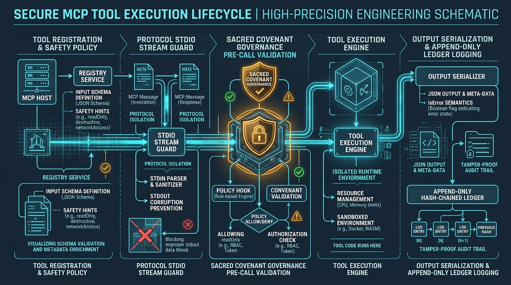

# Developer Guide: Model Context Protocol Enterprise Tooling Fleet

> **Sovereign Operator:** Kirk LaSalle (`kirk@.nexus`)  
> **Audience:** Core Engineers, Agent Architects, and MCP Tool Developers  
> **Fleet Repository:** [`D:\Projects\.mcp`](file:///D:/Projects/.mcp)  
> **Target Protocol Specification:** MCP Standard `2025-11-25`  

---



---

## 1. Architectural Foundations & Philosophy

The `.mcp` monorepo is engineered to provide modular, resilient, and governance-native micro-servers for AI agents.

### Core Principles
1. **Stdio Stream Purity:** Standard output (`stdout`) is strictly reserved for JSON-RPC 2.0 messages. All logging, telemetry, and diagnostics must route to `stderr`.
2. **Honest Error Contracts:** Errors must never be disguised as valid responses (`isError: false`). If a tool fails or throws an exception, the MCP envelope must return `isError: true`.
3. **Project Agnosticism:** Micro-servers must remain free of hardcoded host paths, machine-specific disk drives (`F:/`), or proprietary repository assumptions.
4. **Constitutional Governance:** Destructive or file-modifying tools are bounded by Kirk LaSalle's **Agentic Sacred Covenant** (Laws 2, 9, and 10), mandating explicit consent and append-only audit logging.

---

## 2. Monorepo Structure

```
d:\Projects\.mcp\
├── assets/                     # Hero banners, architecture diagrams, illustrations
│   └── images/
├── docs/                       # Architecture, PRD, User, and Developer documentation
│   ├── PRD.md
│   ├── USER_GUIDE.md
│   └── DEVELOPER_GUIDE.md
├── shared/                     # Shared protocol libraries and adapters
│   ├── stdio_guard.py          # Stdio stream isolation (protect_stdout)
│   ├── sdk_adapter.py          # Unified SDK wrapper & isError handling
│   └── mcp_base_server.py      # Abstract server foundation
├── goliath/                    # Master gateway orchestrator & swarm memory
│   ├── bridges/                # Child server bridges (ids, eds, ipa, vrgc, dpa, websearch)
│   └── server.py               # Master multiplexer entrypoint
├── ids/                        # Intelligent Documentation System (GraphRAG, AST)
├── eds/                        # Educational Data Scraper & multimodal curator
├── ipa/                        # Intelligent Processing Assistant (arXiv, search operators)
├── vrgc/                       # Virtually Robotic GitHub Copilot (SAPR engine)
├── dpa/                        # Digital Project Assistant (NLU, WCAG AA accessibility)
├── web-search/                 # High-throughput search broker (Google + DuckDuckGo)
├── loc/                        # Library of Congress catalog and historical archives
├── AGENTIC_SACRED_COVENANT.md  # Authoritative constitutional governance charter
├── AGENTIC_PRIME_DIRECTIVE.md  # Strategic prime directive
└── Permanent_Active_Directives.txt # Immutable operator directives
```

---

## 3. Protocol Stdio Stream Guard

The most common failure mode in MCP development is stdout pollution: a single stray `print()`, third-party warning, or progress bar corrupts the JSON-RPC frame, causing the client (Claude, Antigravity) to drop the process connection.

### Mandatory Usage Pattern

In **every server entrypoint**, initialize `protect_stdout()` before any other imports:

```python
import sys
from pathlib import Path

# 1. Ensure fleet root is on sys.path
FLEET_ROOT = Path(__file__).resolve().parent.parent
sys.path.insert(0, str(FLEET_ROOT))

# 2. Protect stdout immediately
from shared.stdio_guard import protect_stdout, stdio_server
protect_stdout()

# 3. Safe to import loggers, libraries, and application logic
import logging
logging.basicConfig(
    level=logging.INFO,
    format="%(asctime)s - %(name)s - %(levelname)s - %(message)s",
    handlers=[logging.StreamHandler(sys.stderr)]  # Explicitly log to stderr
)
logger = logging.getLogger("my-mcp-server")
```

### How `stdio_guard.py` Works
1. It duplicates the underlying operating system file descriptor 1 (`os.dup(1)`), saving it privately as `_protocol_out`.
2. It redirects file descriptor 1 and `sys.stdout` to file descriptor 2 (`stderr`).
3. `stdio_server()` yields stream wrappers whose output specifically targets `_protocol_out`, keeping JSON-RPC communication 100% pure.

---

## 4. Building Tools with Official SDK Patterns

### 4.1 FastMCP Pattern (Recommended for New Servers)

For lightweight, functional servers (`web-search`, `loc`):

```python
from mcp.server.fastmcp import FastMCP
from pydantic import BaseModel, Field

mcp = FastMCP("example-server")

class QueryInput(BaseModel):
    query: str = Field(description="Search terms to look up")
    limit: int = Field(default=5, ge=1, le=50, description="Max results")

@mcp.tool(
    name="example_search",
    description="Search repository documentation with semantic matching",
    # Tool Annotations (MCP 2025-11-25)
    annotations={
        "readOnlyHint": True,
        "destructiveHint": False,
        "idempotentHint": True,
        "openWorldHint": False
    }
)
async def example_search(params: QueryInput) -> dict:
    try:
        results = await perform_search(params.query, params.limit)
        return {"query": params.query, "results": results}
    except Exception as e:
        logger.error(f"Search failed: {e}")
        # Raising or returning error payloads
        raise RuntimeError(f"Failed to execute search: {str(e)}")
```

### 4.2 Low-Level Server Pattern (for Complex Subsystems)

For servers with dynamic tools, bridges, or custom lifecycle management (`goliath`, `dpa`, `ipa`):

```python
from mcp.server import Server
from mcp import types
from shared.sdk_adapter import is_error_result, to_text, ToolExecutionError

app = Server("custom-server")

@app.list_tools()
async def list_tools():
    return [
        types.Tool(
            name="custom_action",
            description="Perform a validated custom action",
            inputSchema={
                "type": "object",
                "properties": {
                    "action_name": {"type": "string"}
                },
                "required": ["action_name"]
            }
        )
    ]

@app.call_tool()
async def call_tool(name: str, arguments: dict):
    if name != "custom_action":
        raise ValueError(f"Unknown tool: {name}")
    
    result = execute_action(arguments.get("action_name"))
    
    # Strictly enforce isError semantics
    if is_error_result(result):
        raise ToolExecutionError(to_text(result))
        
    return [types.TextContent(type="text", text=to_text(result))]
```

---

## 5. Adding a Goliath Bridge

When connecting a micro-server to Goliath:

1. Create a bridge module in `goliath/bridges/<server>_bridge.py`.
2. Inherit from `BaseBridge` or implement the standard bridge interface:
   - `get_tools() -> List[Dict[str, Any]]`: Returns tool definitions prefixed with the server namespace (e.g., `ipa_*`).
   - `execute_tool(tool_name: str, arguments: dict) -> Any`: Executes the tool. **Must be async or properly dispatched**.
3. Register the bridge in `goliath/server.py` and `goliath/utils/tool_registry.py`.

---

## 6. Testing & CI Protocol Verification

Every server must pass the automated protocol probe prior to deployment:

```bash
python -u "c:\Users\kirkl\.gemini\antigravity-ide\brain\f3c745f3-a2cb-4916-8ff8-7442f3962343\scratch\probe_v2.py"
```

The probe verifies:
1. **Initialize Handshake:** Confirms server returns valid `protocolVersion` (`2025-11-25`) and server info.
2. **Tool Listing:** Confirms `tools/list` returns non-empty schemas.
3. **Positive Execution:** Runs a deterministic read-only tool to verify live execution.
4. **Negative Execution:** Calls `__nonexistent_tool__` and asserts `res.isError == True`.
