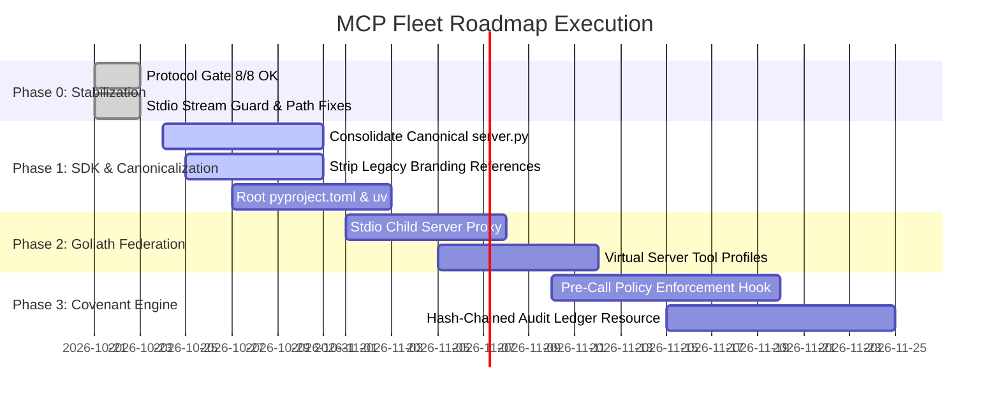

# Product Requirements Document (PRD): Model Context Protocol Enterprise Tooling Fleet

> **Product Name:** `.mcp` — Enterprise Model Context Protocol Fleet  
> **Author & Sovereign Operator:** Kirk LaSalle (`kirk@.nexus`)  
> **Target Protocol Version:** Model Context Protocol (MCP) Standard `2025-11-25`  
> **Version:** 2.0.0 (Production Hardening & Governance Edition)  
> **Last Updated:** 2026-10-23  

---


---

## 1. Executive Summary & Vision

The **`.mcp` Tooling Fleet** is an enterprise-grade suite of specialized micro-servers engineered to furnish modern AI agentic systems (Claude Desktop, Google Antigravity IDE, Cursor, Windsurf, and custom autonomous swarms) with high-reliability external context, multimodal knowledge curation, code intelligence, academic research, and system diagnostics.

### The Core Paradigm: "The Governance-Native MCP Fleet"
While existing market competitors (Exa, Tavily, ContextForge, Docker MCP Gateway) treat tool governance as an operational afterthought (basic token authentication or network sandboxing), the `.mcp` fleet establishes **constitutional governance at the tool dispatch layer**. Every tool call is bound by Kirk LaSalle's **Agentic Sacred Covenant** and **Agentic Prime Directive**, ensuring that:
1. **Destructive Actions Require Explicit Consent:** Tools that alter local files, delete data, or mutate system state require cryptographic approval tokens or client elicitation.
2. **Transparent, Append-Only Ledger:** Every decision, query, and tool execution is logged to a tamper-evident audit ledger.
3. **Zero Hallucinated Tools & Honest Error Semantics:** Servers strictly adhere to standard MCP error protocols (`isError: true` on failure), completely eliminating false-success loops.
4. **Provider-Agnostic Deep Research:** Zero-cost out-of-the-box operation (DuckDuckGo, arXiv API, Library of Congress, Wikipedia) with plug-and-play expansion for commercial API backends.

---

## 2. Platform Architecture & Topology


### 2.1 Deployment Modes

The fleet supports three distinct operating topologies:

```
┌─────────────────────────────────────────────────────────┐
│                    MCP CLIENT                           │
│         (Claude Desktop / Antigravity / Cursor)         │
└──────────────────────┬──────────────────────────────────┘
                       │ JSON-RPC 2.0 over stdio
         ┌─────────────┼─────────────────────┐
         │             │                     │
         ▼             ▼                     ▼
  ┌─────────────┐ ┌──────────┐      ┌────────────────┐
  │  Standalone  │ │Standalone│      │    GOLIATH      │
  │   Servers    │ │ Servers  │      │  Orchestrator   │
  │ • ids       │ │ • web-   │      │  ┌──────────┐  │
  │ • eds       │ │   search │      │  │  Bridge   │  │
  │ • ipa       │ │ • loc    │      │  │  Layer    │  │
  │ • vrgc      │ │          │      │  │ ids ──┐  │  │
  │ • dpa       │ │          │      │  │ eds ──┤  │  │
  └─────────────┘ └──────────┘      │  │ ipa ──┤  │  │
                                    │  │ vrgc ─┤  │  │
                                    │  │ dpa ──┤  │  │
                                    │  │ web ──┘  │  │
                                    │  └──────────┘  │
                                    │       │        │
                                    │  ┌────▼─────┐  │
                                    │  │  Swarm   │  │
                                    │  │  Memory  │  │
                                    │  └──────────┘  │
                                    └────────────────┘
```

1. **Standalone Mode:** The AI client launches and connects directly to individual micro-servers over stdio pipes (e.g., launching only `web-search` and `ids`).
2. **Orchestrated Mode (Goliath):** The client connects to the `goliath` master server, which acts as a gateway multiplexer exposing tools across all 7 child servers and providing unified swarm memory.
3. **Hybrid Mode:** High-frequency, specialized servers run standalone while secondary utility tools run through Goliath.

---

## 3. Server Inventory & Functional Specifications

The monorepo encompasses 8 purpose-built micro-servers:

| Server | Directory | Protocol Role & Primary Capabilities | Canonical Entrypoint |
| :--- | :--- | :--- | :--- |
| **`goliath`** | `goliath/` | **Master Gateway & Swarm Memory**: Multiplexes child bridges, manages cross-server blackboard state, balances GPU VRAM budgets. | `goliath/server.py` |
| **`ids`** | `ids/` | **Intelligent Documentation System**: Semantic code intelligence, GraphRAG knowledge graph construction (`GraphBridge`), AST parsing, documentation scoring. | `ids/server_ai_enhanced.py` |
| **`eds`** | `eds/` | **Educational Data Scraper**: License-compliant academic crawling (MIT OCW, arXiv, Khan Academy, Wikipedia CC-BY-SA), multimodal video/pdf extraction. | `eds/server_enhanced.py` |
| **`ipa`** | `ipa/` | **Intelligent Processing Assistant**: Advanced search operator harness (50+ operators), multi-step academic research synthesis, automated citation generation. | `ipa/server_ultimate.py` |
| **`vrgc`** | `vrgc/` | **Virtually Robotic GitHub Copilot (SAPR)**: Autonomous system diagnostics, hardware profiling, self-healing code remediation, sandboxed candidate validation. | `vrgc/server_enhanced.py` |
| **`dpa`** | `dpa/` | **Digital Project Assistant**: Natural language understanding (NLU), WCAG AA accessibility compliance verification, task scheduling, chronology tracking. | `dpa/server.py` |
| **`web-search`**| `web-search/`| **High-Throughput Search Broker**: Resilient multi-engine web search with Google and DuckDuckGo fallback cascades, markdown webpage extraction. | `web-search/server.py` |
| **`loc`** | `loc/` | **Library of Congress Research**: Real-time querying of the LoC catalog, Chronicling America historical newspapers, and congressional legislative archives. | `loc/server.py` |

---

## 4. Non-Functional Specifications

### 4.1 Stdio Stream Purity & Protocol Safety
- **Requirement:** `stdout` must carry **exclusively valid JSON-RPC 2.0 frames**.
- **Enforcement:** All servers must import and initialize `shared.stdio_guard.protect_stdout()` prior to any module imports. Any accidental `print()` calls, logger outputs, or C-extension outputs are redirected to `stderr`.

### 4.2 Error Handling & Schema Transparency
- **Requirement:** When a tool fails or receives invalid arguments, it must return `isError: true` in the MCP response envelope.
- **Enforcement:** Managed via `shared.sdk_adapter.is_error_result()` and `ToolExecutionError`. Errors must never be disguised as valid content (`isError: false`).

### 4.3 Hardware & Resource Governance
- **Requirement:** Servers must operate within local workstation constraints (supporting 4GB VRAM ceiling profiles for consumer GPUs).
- **Enforcement:** Memory monitor in Goliath verifies GPU allocations before triggering heavy embeddings or model-driven tasks.

### 4.4 Project Agnosticism
- **Requirement:** Micro-servers must operate in any arbitrary software repository without hardcoded host paths or brand-specific assumptions.
- **Enforcement:** Workspace roots must be injected via `MCP_WORKSPACE_ROOT` or inferred from `cwd`.

---

## 5. Constitutional Governance Integration

Governed by Kirk LaSalle's **Agentic Sacred Covenant** (10 Laws):
- **Law 2 & 10 (Consent & Non-Harm):** File-modifying actions in VRGC, DPA, and IDS must execute only within authorized target directories.
- **Law 7 (Absolute Truthfulness):** Capabilities must be truthfully declared; placeholder/mock data in production tools is strictly prohibited.
- **Law 9 (Auditable Reasoning Ledger):** Action records and reasoning traces must be appended to an auditable ledger.

---

## 6. Implementation Roadmap



---

## 7. Success Metrics & Verification

1. **Protocol Compliance:** 100% pass rate on `probe_v2.py` across all 8 micro-servers.
2. **Client Compatibility:** Zero handshake drops or JSON parsing errors in Claude Desktop, Antigravity IDE, and Cursor.
3. **Execution Integrity:** Zero mock data returned from production tool calls.
4. **Audit Assurance:** Complete, uncorrupted append-only records of agent actions.
