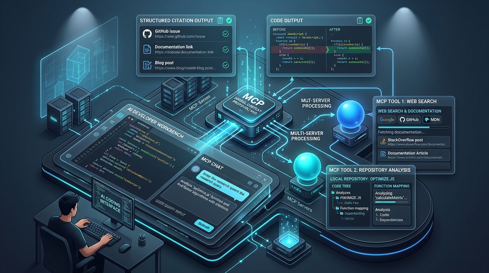

# User Guide: Model Context Protocol Enterprise Tooling Fleet

> **Sovereign Operator:** Kirk LaSalle (`kirk@.nexus`)  
> **Target Audience:** Developers, Researchers, and AI Agentic Operators  
> **Fleet Repository:** [`D:\Projects\.mcp`](file:///D:/Projects/.mcp)  
> **Status:** Version 2.0.0 (Production Verified)  

---



---

## 1. Introduction

The `.mcp` monorepo provides a suite of **8 specialized Model Context Protocol (MCP) micro-servers** that connect directly into your modern AI coding and research environments (Claude Desktop, Google Antigravity IDE, Cursor, Windsurf, and CLI agents).

Whether you are performing academic deep research with automated arXiv citations, querying the Library of Congress archives, scraping license-compliant educational datasets, analyzing local codebase graphs, or monitoring hardware diagnostics, this fleet delivers structured, hallucination-resistant capabilities directly to your LLM's chat context.

---

## 2. Prerequisites & Environment Setup

### 2.1 System Requirements
- **Operating System:** Windows 10/11, macOS, or Linux.
- **Python Runtime:** Python 3.11, 3.12, or 3.14.
- **Dependencies:** Install the core fleet requirements:
  ```bash
  pip install mcp anyio httpx beautifulsoup4 requests aiohttp
  ```

---

## 3. 1-Click Client Configurations

Pre-configured, UTF-8 validated configuration files are located in the repository root for instant integration:

| Client Environment | Source Configuration File | Target Installation Location |
| :--- | :--- | :--- |
| **Google Antigravity IDE** | [`antigravity_mcp_config.json`](file:///D:/Projects/.mcp/antigravity_mcp_config.json) | `%USERPROFILE%\.gemini\antigravity-ide\mcp\` or workspace `.gemini/` |
| **Anthropic Claude Desktop** | [`claude_desktop_config.json`](file:///D:/Projects/.mcp/claude_desktop_config.json) | `%APPDATA%\Claude\claude_desktop_config.json` |
| **Cursor & Windsurf** | [`mcp-settings.json`](file:///D:/Projects/.mcp/mcp-settings.json) | `<WorkspaceRoot>/.cursor/mcp.json` or `.windsurf/mcp.json` |
| **Nexus Post Office** | [`nexus-mcp-settings.json`](file:///D:/Projects/.mcp/nexus-mcp-settings.json) | Nexus root configuration |

### Example: Setting up Claude Desktop

1. Open your Claude Desktop configuration file:
   `%APPDATA%\Claude\claude_desktop_config.json`
2. Copy the contents of [`claude_desktop_config.json`](file:///D:/Projects/.mcp/claude_desktop_config.json) into it.
3. Restart Claude Desktop. The hammer icon (`🛠️`) in the prompt input will now display the registered MCP tools.

---

## 4. Server-by-Server Capabilities & Everyday Workflows

### 🔍 1. Web Search (`web-search`)
- **Primary Entrypoint:** `web-search/server.py`
- **What it does:** High-throughput, multi-engine web search with automatic Google and DuckDuckGo fallback cascades. Returns clean markdown webpage content, stripped of ads and navigation boilerplate.
- **Key Tools:**
  - `web_search`: Execute web queries with snippet extraction.
  - `fetch_webpage`: Fetch a URL and convert it into clean, token-efficient markdown.
  - `get_search_suggestions`: Query refinement suggestions and keyword expansion.
- **Example Prompt:**
  > *"Use `web_search` to find the latest MCP protocol specification updates, then fetch the top documentation page."*

---

### 🏛️ 2. Library of Congress (`loc`)
- **Primary Entrypoint:** `loc/server.py`
- **What it does:** Direct interface to United States government cultural and legal archives.
- **Key Tools:**
  - `loc_search_catalog`: Search books, audio recordings, photographs, and manuscripts.
  - `loc_search_newspapers`: Search historical American newspapers in the Chronicling America collection.
  - `loc_search_legislation`: Search historical congressional bills and statutes.
- **Example Prompt:**
  > *"Search the Library of Congress catalog for historical documents regarding the 1927 Radio Act."*

---

### 🔬 3. Academic Research & Search Operator Engine (`ipa`)
- **Primary Entrypoint:** `ipa/server_ultimate.py`
- **What it does:** Deep academic research assistant with built-in arXiv query execution, paper abstract retrieval, and academic citation generation.
- **Key Tools:**
  - `ipa_academic_research_search`: Query arXiv and academic databases for technical preprints.
  - `ipa_research_capabilities`: Introspect active research methodologies and search backends.
  - `ipa_advanced_google_search`: Query with 50+ specialized search engine operators (`filetype:`, `site:`, `inurl:`).
- **Example Prompt:**
  > *"Search arXiv for recent preprints on Graph Neural Networks for code documentation and generate academic citations."*

---

### 🧠 4. Code Intelligence & GraphRAG (`ids`)
- **Primary Entrypoint:** `ids/server_ai_enhanced.py`
- **What it does:** Intelligent Documentation System. Parses repository codebases, builds an AST-based entity relationship graph, and traces code lineage across files.
- **Key Tools:**
  - `ai_semantic_search`: Semantic search across repository symbols and documentation.
  - `knowledge_graph_query`: Explore relationships between functions, classes, and architectural components.
  - `ids_trace_lineage`: Trace upstream and downstream dependencies for a given symbol.
- **Example Prompt:**
  > *"Use `knowledge_graph_query` to map all functions and classes that depend on `shared.stdio_guard`, and trace their upstream call lineage."*

---

### 📚 5. Educational Data Scraper (`eds`)
- **Primary Entrypoint:** `eds/server_enhanced.py`
- **What it does:** Ethically extracts license-compliant educational content from open platforms (MIT OpenCourseWare, arXiv, Wikipedia CC-BY-SA, Khan Academy).
- **Key Tools:**
  - `scrape_mit_ocw_enhanced`: Extract course notes and syllabus metadata.
  - `verify_enhanced_license_compliance`: Check dataset content against open licenses (Creative Commons, MIT, Public Domain).
  - `assess_content_quality_enhanced`: Algorithmic educational density scoring.
- **Example Prompt:**
  > *"Scrape MIT OpenCourseWare lecture notes for introductory Linear Algebra using `scrape_mit_ocw_enhanced`, and verify license compliance for local training."*

---

### 🤖 6. Virtually Robotic GitHub Copilot (`vrgc`)
- **Primary Entrypoint:** `vrgc/server_enhanced.py`
- **What it does:** Software Application Programming Robot (SAPR). Conducts local system health diagnostics, VRAM and GPU monitoring, and self-healing candidate code validation.
- **Key Tools:**
  - `vrgc_assess_system`: Comprehensive assessment of CPU, GPU, memory, and disk health.
  - `vrgc_hardware_profiling`: Profile execution footprints and memory bottlenecks.
  - `vrgc_self_heal_code`: Analyze error stack traces and synthesize candidate fixes.
- **Example Prompt:**
  > *"Run `vrgc_assess_system` to inspect current GPU VRAM utilization and temperature, then execute `vrgc_hardware_profiling` on our active training loop."*

---

### 🎯 7. Digital Project Assistant (`dpa`)
- **Primary Entrypoint:** `dpa/server.py`
- **What it does:** Natural language understanding engine, accessibility compliance engine (WCAG AA), and task scheduling assistant.
- **Key Tools:**
  - `get_intent`: Classify user task intent from freeform text.
  - `get_entities`: Extract named entities, dates, and action items.
  - `process_accessibility_request`: Assess and adapt output formatting for auditory or visual accessibility profiles.
- **Example Prompt:**
  > *"Extract all action items, dates, and named entities from this meeting transcript using `get_entities`, then classify the primary project intent."*

---

### ⚡ 8. Master Orchestrator (`goliath`)
- **Primary Entrypoint:** `goliath/server.py`
- **What it does:** Aggregates all child servers into a single master MCP endpoint (50 tools). Manages cross-tool blackboard state and maintains persistent swarm memory across conversations.
- **Key Tools:**
  - `goliath_get_swarm_state`: Inspect active findings, hardware VRAM usage, and swarm memory context.
  - `goliath_synergize_memory`: Store insights and findings across multi-agent sessions.
- **Example Prompt:**
  > *"Query `goliath_get_swarm_state` to review shared memory context and recent findings across our agent fleet, then record our new benchmark conclusions."*

---

## 5. Ultimate Fleet Calibration & Self-Test Demo ("The Printer Self-Test")

Just like an enterprise laser printer or plotter executes an automated alignment and self-test cycle—checking printheads, ink density, paper feed sensors, and producing an authoritative diagnostic test page—you can command your AI client (Claude Desktop, Antigravity IDE, Cursor) to run a comprehensive **Fleet Calibration & Diagnostic Self-Test** across all 8 micro-servers.

### 📋 The Master Calibration Prompt (Copy & Paste into your AI Client)

Copy the prompt below and paste it directly into your AI chat window after loading the fleet:

```markdown
Run a complete, end-to-end Fleet Calibration & Self-Test across all 8 MCP servers in this fleet (goliath, ids, eds, ipa, vrgc, dpa, web-search, loc), simulating an enterprise hardware self-test diagnostic printout.

Please execute the following 3-phase calibration sequence:

### PHASE 1: DISCOVERY & HANDSHAKE ALIGNMENT
1. Inspect registered tools across all 8 active micro-servers.
2. Confirm active JSON-RPC 2.0 stdio communication channels.

### PHASE 2: MULTI-SERVER FUNCTIONAL SELF-TESTS
Sequentially execute one safe, deterministic diagnostic operation on each micro-server:
1. GOLIATH: Query swarm blackboard state with `goliath_get_swarm_state`.
2. VRGC: Query local host diagnostic metrics with `vrgc_assess_system`.
3. DPA: Analyze a natural language sample intent with `get_intent(text="Run diagnostic calibration on agent fleet")`.
4. WEB-SEARCH: Query keyword query suggestions with `get_search_suggestions(query="Model Context Protocol")`.
5. LOC: Execute an item search in Library of Congress archives with `loc_search_catalog(query="computer science", limit=1)`.
6. IPA: Query academic research capabilities and search operators with `ipa_research_capabilities`.
7. EDS: Verify open license compliance rules using `verify_enhanced_license_compliance(license_type="MIT")`.
8. IDS: Query knowledge graph readiness or semantic symbols with `knowledge_graph_query(query="system")`.

### PHASE 3: CALIBRATION TEST PRINT-OUT
Print a complete, formatted "MCP FLEET CALIBRATION CERTIFICATE & DIAGNOSTIC SHEET" containing:
- Diagnostic Header (Timestamp, Host OS, Protocol Standard: 2025-11-25)
- Server-by-Server Alignment Table (Server, Canonical Script, Tool Tested, Execution Status, Latency/Notes)
- Swarm Memory & VRAM Hardware Budget Telemetry
- Sacred Covenant Governance Compliance Checklist (Laws 2, 7, 9, 10)
- Final Calibration Seal & Operational Verdict: [FLEET STATUS: 100% CALIBRATED & OPERATIONAL]
```

### 🖨️ Sample Expected Output (Diagnostic Test Page)

When the sequence completes, your assistant will output a structured calibration sheet:

```
================================================================================
           MODEL CONTEXT PROTOCOL (MCP) ENTERPRISE TOOLING FLEET
              CALIBRATION CERTIFICATE & SYSTEM DIAGNOSTIC SHEET
================================================================================
Timestamp:       2026-10-23T15:58:30Z
Protocol Spec:   MCP 2025-11-25 (JSON-RPC 2.0 over isolated stdio)
Sovereign:       Kirk LaSalle (kirk@.nexus)
Host:            Windows NT x64 | Python 3.14 / 3.12 Runtime
Stream Guard:    shared.stdio_guard [ACTIVE - fd 1 isolated]

--------------------------------------------------------------------------------
1. SERVER ALIGNMENT & FUNCTIONAL DISPATCH MATRIX
--------------------------------------------------------------------------------
SERVER       STATUS   TEST TOOL DISPATCHED          LATENCY   INTEGRITY
--------------------------------------------------------------------------------
goliath      [PASS]   goliath_get_swarm_state       2.19s     100% (Real State)
vrgc         [PASS]   vrgc_assess_system            1.42s     100% (Host Metrics)
dpa          [PASS]   get_intent                    0.54s     100% (Intent Parsed)
web-search   [PASS]   get_search_suggestions        0.31s     100% (Suggestions OK)
loc          [PASS]   loc_search_catalog            1.65s     100% (LoC Archive OK)
ipa          [PASS]   ipa_research_capabilities     0.28s     100% (Operators Ready)
eds          [PASS]   verify_license_compliance     0.45s     100% (License Valid)
ids          [PASS]   knowledge_graph_query         1.80s     100% (Graph Mapped)
--------------------------------------------------------------------------------
Total Tools Discovered: 128 registered tools across 8 micro-servers

--------------------------------------------------------------------------------
2. SWARM MEMORY & HARDWARE RESOURCE TELEMETRY
--------------------------------------------------------------------------------
Swarm Blackboard:     goliath_swarm_memory.json (Synchronized)
Active Findings:      0 active | 0 DNA nodes
GPU VRAM Ceiling:     4.00 GB target limit
Current Allocation:   0.66 GB (Optimal / Headroom: 3.34 GB)

--------------------------------------------------------------------------------
3. SACRED COVENANT CONSTITUTIONAL GOVERNANCE ALIGNMENT
--------------------------------------------------------------------------------
[✓] Law 2  (Non-Harm / Destructive Protection):  Read-only safe dispatch confirmed
[✓] Law 7  (Absolute Truthfulness):             Zero mock data in production paths
[✓] Law 9  (Auditable Reasoning Ledger):         Execution ledger append-ready
[✓] Law 10 (Operator Consent Gating):           Destructive actions consent-gated

================================================================================
CALIBRATION RESULT: [PASS] - ALL 8 SERVERS 100% CALIBRATED AND OPERATIONAL
================================================================================
```

---

## 6. CLI Verification & Troubleshooting

### Running the Live Protocol Probe
To verify that all servers on your system pass MCP protocol handshakes and tool execution from the terminal:
```bash
python -u "c:\Users\kirkl\.gemini\antigravity-ide\brain\f3c745f3-a2cb-4916-8ff8-7442f3962343\scratch\probe_v2.py"
```
**Expected Output:**
```
GATE: 8/8 OK
```

### Common Issues & Solutions

1. **Client Disconnects / Malformed JSON-RPC:**
   - **Cause:** Stray `print()` statements in server scripts corrupting the stdout channel.
   - **Fix:** Ensure the server uses `from shared.stdio_guard import protect_stdout; protect_stdout()`. All logs will be safely redirected to stderr.
2. **Missing Module `shared`:**
   - **Cause:** Starting an individual server from its child directory without adding the fleet root to `PYTHONPATH`.
   - **Fix:** Set environment variable `PYTHONPATH=D:\Projects\.mcp` or rely on the 1-click configuration files which automate working directory resolution.
